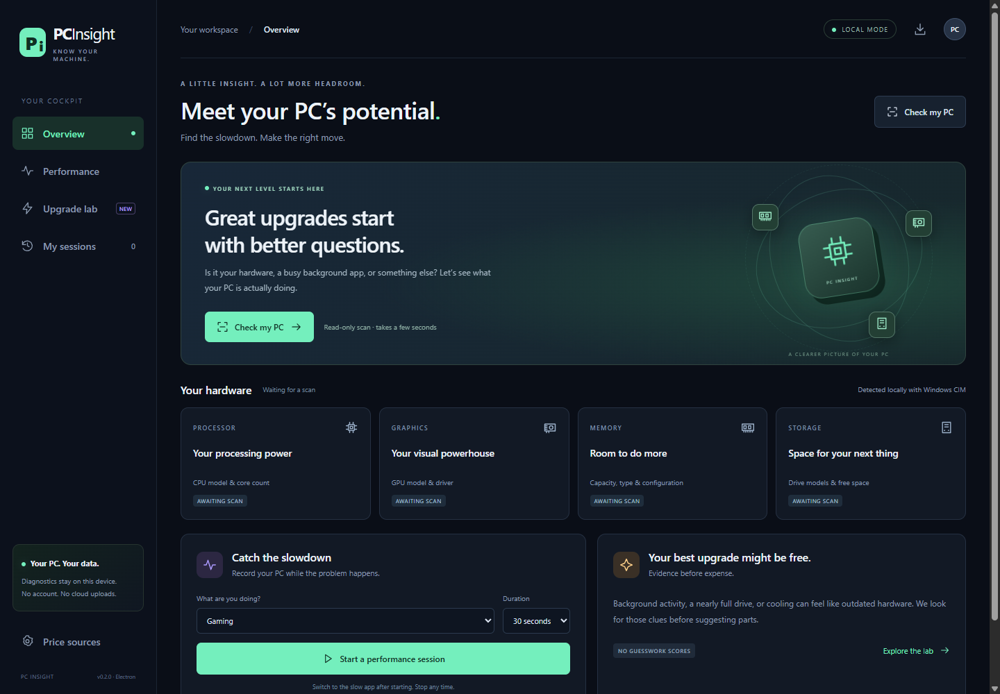

# PC Insight

**Know your machine. Keep your upgrade money until the evidence adds up.**

A Windows performance cockpit built with **Electron**, **Chart.js**, and a sandboxed HTML/CSS interface. Local hardware discovery, live workload charts, short benchmarks, session comparisons and conditional upgrade candidates with real retailer price observations.



## Download

Get `PCInsight-*-win-x64.exe` from [Releases](https://github.com/DarrellBest/pc-insight/releases). Run the portable executable on Windows 10/11 x64. No separate .NET or Node installation. Builds are unsigned; SHA-256 checksums are attached. The original WPF prototype is retained in `legacy/wpf/`; Electron is the current app.

## The cockpit

- **Overview:** animated illustration, CPU/GPU/memory/storage cards, motherboard identity and a guided “Check my PC” flow.
- **Performance:** live resource timelines, gauges, threshold occupancy chart, top CPU processes and evidence cards. Missing counters are gaps, not zeros.
- **Quick benchmarks:** worker-thread SHA-256, cache-sensitive memory copy and a bounded 64 MiB temporary-file write. These are not standardized cross-PC scores, full RAM bandwidth measurements or GPU benchmarks.
- **Upgrade lab:** budget slider, real products, seller identity, price provenance, freshness gates, conditional compatibility checks and explanations.
- **My sessions:** review the last ten captures and compare the latest two. Sessions stay in memory and clear on exit or rescan. Lower utilization alone does not establish faster performance.
- **JSON export:** hardware, samples, findings and benchmarks. Reports may contain process names; review before sharing.

## Diagnose before buying

Scan, select an activity and record for 30, 60 or 120 seconds while using the slow application. Then close unnecessary apps or change settings and repeat an equivalent workload. Sampling interval depends on CIM query time; captures may slightly exceed the target duration.

Pressure requires at least five valid samples, 80% counter coverage and at least half of valid samples above threshold: CPU/RAM/disk 90%, busiest core/GPU engine 95%. Pressure is evidence, not proof of root cause. GPU counters can reflect video or compute rather than rendering. Background processes may include the intended workload. Disk busy time does not measure latency.

NVIDIA GPU temperature and software thermal-slowdown flags are sampled if `nvidia-smi` is available and supports the query. CPU and other-vendor thermal coverage remains unknown. No kernel driver is installed. Missing sensors never mean overheating has been ruled out.

## Real prices, with honest limits

The starter catalog has **three real US listings**, with exact models, seller identity and dated source observations:

| Part | Observed USD price | Seller | Source date |
| --- | ---: | --- | --- |
| Corsair Vengeance LPX 32 GB DDR4-3200, CMK32GX4M2E3200C16 | $259.99 | Newegg | October 24, 2026 |
| Samsung 990 PRO 2 TB, MZ-V9P2T0B/AM | $409.99 | Newegg seller option | October 24, 2026 |
| Gigabyte Windforce RTX 5070, GV-N5070WF3OC-12GD | $1,099.99 | Halfmoon Tech Store via Newegg Marketplace | October 23, 2026 |

Sources: [Corsair](https://www.newegg.com/p/N82E16820236541), [Samsung](https://www.newegg.com/p/N82E16820147861), [Gigabyte](https://www.newegg.com/p/N82E16814932777). These are **dated observations, not guaranteed live prices or stock**. Default sellers can change. Check seller selection, shipping, tax, warranty and checkout price. This small catalog is not an exhaustive best-price comparison service.

**Refresh prices** requests a public structured product offer, requiring exact item/model identity, USD price, seller and in-stock status. Ambiguous aggregate offers are rejected. Newegg returned HTTP 403 in development, so a fresh direct fetch could not be verified here. On a block, timeout, redirect or unsupported format, the old price and date remain visible. The app never bypasses access controls or relabels stale prices as live. Prices older than 48 hours cannot qualify as recommendations.

For an official live source, enter your own [Best Buy API key](https://developer.bestbuy.com/) in **Price sources**. The [Products API](https://bestbuyapis.github.io/api-documentation/) adapter matches exact model numbers, checks new condition and online availability, and retrieves sale price and product URL. The key is encrypted with Windows-backed Electron `safeStorage` and excluded from reports. The adapter has offline regression coverage but has **not** been tested with a real API key. No credentials are bundled. No hardware data is sent to retailers.

## Recommendation safeguards

- RAM must match DDR generation and DIMM form factor, increase total capacity as a replacement kit, and respect known firmware capacity limits. Confirm motherboard QVL, module count and BIOS yourself.
- The SSD candidate needs a detected HDD. Confirm that the slow workload is on that HDD and an M.2 NVMe slot is available. An existing SSD is not assumed inferior.
- The RTX 5070 candidate is restricted to a small recognized set of older GPUs. Unknown/higher-end GPUs, including RTX 4090, are not assumed to benefit. Confirm PSU, connectors, dimensions and workload-specific benchmarks.
- Desktop parts are excluded when Windows identifies a laptop. CPU offers are withheld pending maintained exact motherboard/BIOS and workload comparison data.
- Ranking is measured pressure fraction divided by price: a transparent prioritization heuristic, **not a predicted FPS gain or measured performance-per-dollar score**. No numerical uplift is fabricated. Budget applies to each part individually, not a combined basket.

“No purchase justified yet” is an expected outcome, particularly for high-end builds. Catalog parts can still be inspected without being labeled recommendations.

## Build and package

Install Node.js 22+ on Windows:

```powershell
npm ci
npm test
npm start
npm run package
```

`npm run build` bundles and **minifies JavaScript, CSS, main process, preload and benchmark worker** with esbuild. No production source maps. Electron Builder packages ASAR with maximum compression and writes a portable x64 executable to `release/`. Chromium/runtime size still dominates the download; minification cannot make Electron tiny.

`npm run smoke` runs a hidden real Windows scan, 30-second activity capture and benchmark worker, checks the rendered inventory, and saves ignored screenshots in `smoke-output/`. Unit tests use synthetic fixtures for pressure gates, missing counters, memory compatibility, downgrade protection, price freshness, seller identity and URL restrictions.

GitHub Actions installs locked dependencies, tests, packages and uploads artifacts. Push a `v*` tag or publish a GitHub release to attach the executable and checksum automatically. Only the release job has repository write permission.

## Privacy and security

Node integration is disabled in the renderer; context isolation and sandboxing are enabled. A narrow preload exposes specific operations. IPC validates the calling frame. Navigation, popups and permissions are blocked. Content Security Policy disallows renderer network access. Main-process outbound links are restricted to known HTTPS retailer hosts. PowerShell script paths and capture durations are fixed/validated. No remote HTML is rendered.

No diagnostic data leaves the PC. Retailer requests contain product identifiers and, for Best Buy, the configured key. The optional encrypted key persists in the per-user app directory; diagnostics persist only when explicitly exported. PowerShell/CIM must be available; managed-device policy may block scripts. Execution policy is changed only for each child process, never globally.

## Layout

`ui/`: interface and charts · `electron/`: privileged operations, price adapters and diagnosis · `Scripts/`: Windows collectors · `test/`: regression checks · `tools/build.mjs`: minification · `.github/workflows/build.yml`: releases.

MIT licensed. Electron/runtime and bundled library licenses are included by the packager. References: [Electron security](https://www.electronjs.org/docs/latest/tutorial/security), [Windows performance counters](https://learn.microsoft.com/windows/win32/perfctrs).
